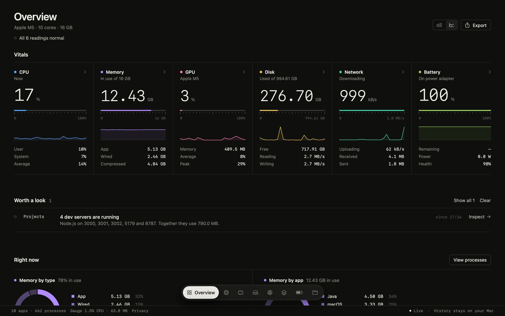

<div align="center">


# Gauge

**A precise, private system monitor for macOS.**<br>
Native SwiftUI. Live readings. History stays on your Mac.

<a href="#build-from-source"></a>
<a href="https://swift.org"></a>
<a href="app/Sources/Gauge"></a>
<a href="#history-stays-on-your-mac"></a>
<a href="#updates"></a>
<a href="LICENSE"></a>

[Download](#install) · [Features](#features) · [Screenshots](#a-closer-look) · [Privacy](#history-stays-on-your-mac) · [Updates](#updates) · [Build](#build-from-source) · [Roadmap](#roadmap)

<br>



<sub>Real readings from a MacBook Air (Apple M5), rendered by the app's own SwiftUI views.</sub>

</div>

<br>

## Install

**[Download Gauge for Mac](https://github.com/byalex33/gauge/releases/latest/download/Gauge.dmg)**. It needs macOS 26 or later on Apple silicon.

1. Open `Gauge.dmg` and drag Gauge to Applications.
2. Open Gauge. Builds aren't notarized yet, so the first time macOS may say it can't verify the developer: go to **System Settings › Privacy & Security** and click **Open Anyway**. You only do this once.
3. That's it. Gauge offers new versions itself, or use **Gauge › Check for Updates…**.

## Features

Gauge is built like a measuring instrument rather than a dashboard: six vitals sit side by side like channels on a mixing desk, each with its own colour, a monospaced readout, a tick-mark scale and a fine trace.

- **Six live vitals, every 2 seconds.** CPU, memory and memory pressure, GPU, disk space and throughput, network, and battery. Every scale fills with what's in use, so a fuller bar always means the same thing.
- **In the menu bar.** CPU sits in the menu bar, and a click shows all six vitals and the top notice. With it on, closing the window keeps Gauge running; turn it off in Settings.
- **A page for every metric.** Click a channel for a large chart with ranges from Live to 7 days, plus average, low and peak, full readings and the top apps.
- **Hover for exact values.** A crosshair follows the pointer and reads out the time and every series at that moment.
- **Worth a look.** Plain-language notices when something needs attention, such as elevated memory pressure, an app pinning a core, a nearly full disk, or dev servers left running. It also flags an app whose memory keeps growing, CPU that's higher than usual for this Mac at this time of day (learned from your own history), and how much battery went while the Mac was asleep and what woke it. If macOS slows the processor to manage heat, Gauge says so.
- **Timeline.** A flight recorder for your Mac. Every 10 seconds Gauge saves which apps were busiest, and it notes sleep, wake, apps opening and quitting, and thermal changes. Scrub back to any moment (⌘9) to see what was running when things slowed down. Battery health and disk use are tracked over months, with a "This week" summary.
- **Right now.** Ring breakdowns of memory by type, memory by app, CPU by app and the startup disk.
- **Apps, not processes.** Helper processes are grouped under their app, so "Google Chrome" is one row, not forty. Quit or force quit an app from the process table, or from the top apps on the CPU and Memory pages (Control-click).
- **Dev-server aware.** Spots Node, Python, Ruby, Bun, Deno and other local servers listening on TCP ports, with the folder each one runs in. Stop a forgotten server from the Projects page; Gauge sends the same signal as Control-C and offers Force stop if it doesn't exit. Game servers, such as Minecraft on Java, are listed but not counted as dev servers.
- **Built for developers.** The Projects page shows who holds port 3000 and the other usual dev ports, and flags a server probably left running in an old project. It also lists Docker, OrbStack, Colima or Podman containers with their CPU and memory, and measures build caches such as DerivedData, `~/.npm` and `node_modules`, with **Move to Trash**. For local AI models from Ollama, LM Studio, llama.cpp or MLX, it shows memory use and estimates how large a model fits right now.
- **Readable by your tools and agents.** Turn on **Let local tools read Gauge** in Settings and the bundled `gauge` command prints vitals, top apps, dev servers, port owners, notices and history (`gauge port 3000`, `gauge history cpu --minutes 60`, `--json`). `gauge mcp` is a read-only MCP server for coding agents. It's off by default and uses a socket only your account can open.
- **Shows its own cost.** The status bar shows Gauge's own CPU and memory, so you can see what monitoring costs, and counts every network request Gauge has made this session (normally none).
- **One signal colour.** Orange is reserved for readings that need attention, so a warning never hides among the metric colours.
- **Feels native.** Floating navigation island, ⌘1–⌘9 shortcuts, Esc to go back, sortable process table, Settings window, and CSV export.
- **Keeps itself up to date.** Signed updates through Sparkle, only if you allow it.

## A closer look

<table>
  <tr>
    <td width="50%"></td>
    <td width="50%"></td>
  </tr>
  <tr>
    <td align="center"><sub><b>CPU</b> · live chart with hover readout and top apps</sub></td>
    <td align="center"><sub><b>Network</b> · download and upload on one chart</sub></td>
  </tr>
  <tr>
    <td width="50%"></td>
    <td width="50%"></td>
  </tr>
  <tr>
    <td align="center"><sub><b>Memory</b> · pressure, composition and top apps</sub></td>
    <td align="center"><sub><b>Right now</b> · ring breakdowns in each metric's colour</sub></td>
  </tr>
</table>

<sub>Hover readouts in these images are positioned by the renderer rather than a real pointer.</sub>

## What it measures

Everything comes from public macOS interfaces. Gauge needs no administrator access and installs no helpers.

| Reading | Source |
| :-- | :-- |
| CPU load, user and system | `host_processor_info` |
| Memory, composition, pressure, swap | `host_statistics64`, `sysctl` |
| GPU utilisation and memory | IOKit `IOAccelerator` performance statistics |
| Disk space, read and write throughput | Volume resource values, IOKit `IOBlockStorageDriver` |
| Network download and upload | `sysctl` 64-bit interface counters (Wi-Fi, Ethernet, cellular) |
| Battery charge, time, power and health | IOKit power sources and `AppleSmartBattery` |
| Per-app CPU and memory footprint | `libproc` |
| Local dev servers and port owners | `proc_pidinfo` listening TCP sockets |
| Thermal state | `ProcessInfo.thermalState` |
| Battery used while asleep, wake reasons | `pmset -g log` |
| Containers | `docker stats` against the runtime's local socket |
| Build caches, local AI models | Folder sizes on disk |
| Audio output and Bluetooth accessory batteries | CoreAudio, IOKit |

> [!NOTE]
> Temperature and fan sensors aren't read yet; they need a privileged helper. Processes owned by other users appear only in the memory total, as "Other & system".

## History stays on your Mac

- Readings are averaged every **10 seconds** into a SQLite file at `~/Library/Application Support/Gauge/history.sqlite`.
- Your history is **never uploaded**. Gauge has no analytics, no telemetry, no account and no sync.
- The flight recorder's app readings and events live in the same file. A small daily row of battery health and disk use is kept for two years so trends can span months.
- The **only network request** is the optional update check described below. The status bar counts requests, and the Privacy sheet lists each one with its time and URL.
- The file's format is documented in [`docs/history-schema.md`](docs/history-schema.md), so you can query it yourself with `sqlite3 -readonly`.
- The `gauge` command and MCP server are off by default. When on, they answer only over a Unix socket that only your account can open; anything an agent reads leaves your Mac only if that agent sends it elsewhere.
- Choose how long history is kept (1 to 90 days), reveal the file in Finder, or **Clear History** from Settings (⌘,).
- Export what's on screen as CSV with **File › Export History** (⌘E).

## Updates

Gauge uses [Sparkle](https://sparkle-project.org) to update itself.

- On the second launch, Gauge **asks** whether to check for updates automatically. You can change this, or check by hand, in Settings and in **Gauge › Check for Updates…**.
- A check downloads one small feed, [`gauge.alex.codes/appcast.xml`](https://gauge.alex.codes/appcast.xml). Gauge sends **no system profile** and nothing about your Mac.
- Updates are disk images on [GitHub Releases](https://github.com/byalex33/gauge/releases). Each one is signed with an EdDSA key, and Gauge refuses any update whose signature doesn't match the key built into the app.

## Design


Warm graphite and off-white, hairline rules instead of cards, and a flat colour for each metric that runs through its dot, scale, trace, rings and history line. Rings use tonal steps of the same colour. No gradients, glows or glass: colour carries meaning, and motion stays quick. Pages crossfade, readouts roll to new values, and scales glide.

The icon's dial arc draws a **G**, and the orange needle is its crossbar. Its source is [`app/Resources/AppIcon.svg`](app/Resources/AppIcon.svg).

## Build from source

**Requirements:** macOS 26 or later and Swift 6.2 (Xcode 26 or the Command Line Tools).

```bash
git clone https://github.com/byalex33/gauge.git
cd gauge/app
./build.sh --open
```

`build.sh` compiles a release build with Swift Package Manager, embeds Sparkle, assembles `app/build/Gauge.app` with its icon, and signs it ad hoc for local use. Releases are made with `app/release.sh`; see [`app/README.md`](app/README.md).

Run the tests (Swift Testing, no Xcode needed) with:

```bash
./test.sh
```

## Keyboard shortcuts

| Shortcut | Action |
| :-- | :-- |
| <kbd>⌘</kbd> <kbd>1</kbd> | Overview |
| <kbd>⌘</kbd> <kbd>2</kbd>–<kbd>7</kbd> | CPU, Memory, Disk, Network, GPU, Battery |
| <kbd>⌘</kbd> <kbd>8</kbd> | Projects (dev servers, ports, containers, caches, local AI) |
| <kbd>⌘</kbd> <kbd>9</kbd> | Timeline (what was running, trends) |
| <kbd>Esc</kbd> | Back to Overview |
| <kbd>⌘</kbd> <kbd>E</kbd> | Export history as CSV |
| <kbd>⌘</kbd> <kbd>,</kbd> | Settings: history retention and Clear History |

## Project structure

```text
gauge/
├── app/                      Native macOS app (Swift Package)
│   ├── Sources/Gauge/
│   │   ├── Sampler.swift     Reads system counters (Mach, sysctl, IOKit, libproc, CoreAudio)
│   │   ├── Monitor.swift     Turns readings into vitals and breakdowns
│   │   ├── Notices.swift     Rules for "Worth a look" and the status line
│   │   ├── MenuBar.swift     Menu bar extra and its panel
│   │   ├── HistoryStore.swift  Local SQLite history
│   │   ├── Detail.swift      Metric pages with interactive Swift Charts
│   │   ├── Insights.swift    Memory growth, "higher than usual" and sleep drain rules
│   │   ├── Recorder.swift    Flight recorder: top apps per moment and events
│   │   ├── Timeline.swift    Timeline page and long-term trends
│   │   ├── DevTools.swift    Ports, containers, build caches and local AI models
│   │   ├── LocalAPI.swift    Opt-in Unix socket for the gauge command
│   │   ├── Sections.swift    Overview sections
│   │   └── …
│   ├── Sources/GaugeKit/     Socket protocol and MCP server shared by the app and CLI
│   ├── Sources/GaugeCLI/     The gauge command (and `gauge mcp`)
│   ├── Tests/GaugeTests/     Formatting, parsing, notices, insights, recorder, dev tools, MCP
│   ├── Resources/            Info.plist, AppIcon.svg / .icns
│   ├── build.sh
│   └── test.sh
├── prototype/index.html      Interactive HTML design prototype (sample data)
└── docs/                     README images and history-schema.md
```

The HTML prototype is the design reference. Open [`prototype/index.html`](prototype/index.html) in a browser to explore the layout with sample data.

## Roadmap

- [x] Live CPU, memory, GPU, disk, network and battery
- [x] Per-app usage and dev-server detection
- [x] Interactive metric pages with saved history
- [x] Local-only history with retention controls
- [x] Installable disk image with signed, opt-in updates
- [ ] Notarized, Developer ID–signed builds
- [ ] Temperature and fan sensors via a privileged helper
- [x] Menu bar extra
- [x] Tests for formatting, parsing, notices and history
- [x] Timeline with per-moment app readings and long-term trends
- [x] Developer tools: ports, containers, build caches, local AI models
- [x] `gauge` command and MCP server for local tools and agents
- [ ] Shortcuts actions (App Intents need Xcode's metadata step)
- [ ] Desktop widgets

## License

[MIT](LICENSE) © 2026 Alex
